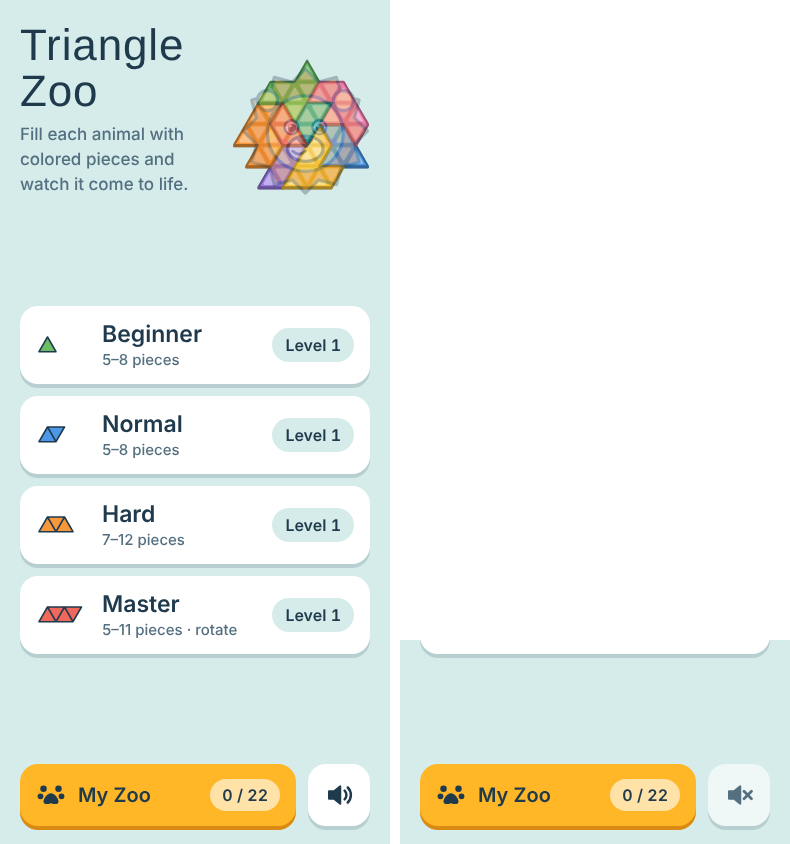

# Triangle Zoo（角角入位）

A portrait triangle-tile puzzle for [CrazyGames](https://www.crazygames.com). Each level is the silhouette of an animal, cut out of a triangle grid. You drag the colored pieces in, rotating or flipping them as needed, until they fill the shape. On completion, the pieces turn into a cartoon animal that blinks and hops, and it is added to the "My Zoo" album.

- Single-file HTML5 game (canvas + plain JS, no framework). The whole build is one `index.html` of about 1.8 MB.
- Portrait 9:16 layout. On a landscape screen, the game stays in a centered portrait column.
- 22 animals, four difficulty tiers (Beginner / Easy / Medium / Hard), level select, replay, and a 3-star rating.
- Integrates CrazyGames SDK v3: loading/gameplay events, happytime, midgame ads, cloud saves and the platform mute setting. It also runs without the SDK (offline or blocked), in which case saves fall back to `localStorage`.
- UI is in English only.



## Project structure

```
trianglezoo/
├── dist/
│   └── index.html          # Built game. This is the file you upload to CrazyGames
├── src/
│   ├── original.html       # Original game (landscape, Chinese/English): the starting point of the build
│   ├── patches/            # Build steps, run in order, each one input HTML → output HTML
│   │   ├── port.py         # 1. Portrait layout, CrazyGames SDK, English only, boot flow
│   │   ├── zoo.py          # 2. Animal boards, illustrations, win animation, My Zoo album
│   │   ├── levels.py       # 3. Level select, replay, stars per level
│   │   └── foot.py         # 4. Menu footer (My Zoo + sound button)
│   └── zoo/                # JS that zoo.py injects into the page
│       ├── zoo_data.js     # The 22 animals: id, color, eyes and other face data
│       ├── zoo_art.js      # Animal SVG art; rasterizes the art into a triangle board (alpha mask + IoU)
│       ├── zoo_face.js     # Faces, blinking, hopping, star burst on win
│       └── zoo_screen.js   # "My Zoo" album screen
├── scripts/
│   └── build.sh            # Runs the four steps and writes dist/index.html
├── tests/
│   └── smoke.js            # Playwright smoke test (phone / desktop / no SDK)
├── docs/screenshots/       # Screenshots
└── package.json            # npm scripts: build / start / test
```

### Code structure inside `dist/index.html`

The script is split into sections by `// ===================== name =====================` comments. The main ones:

| Section | Purpose |
| --- | --- |
| triangle grid | Triangle coordinates `(i, j, t)`, vertex and center conversion |
| level generator / solver | Splits a board into pieces, plus an exact-cover solver that guarantees every level is solvable |
| zoo animals / zoo: illustrations | Animal data, SVG art, board generation from the art |
| difficulty curve | `TIERS`: piece counts and board sizes per difficulty |
| save | Save data (key `tri-zoo-v1`): progress, stars and animal per level, album, sound |
| layout / frame loop / input | Portrait layout, rendering, drag / rotate / flip |
| menu / zoo album | Main menu, level select, album |
| CrazyGames | `cg*` wrappers around the SDK; every call degrades gracefully without the SDK |

## Running locally

You need Python 3 (for the build and the local server). The tests also need Node.js 18+.

```bash
# Play directly: just open the built file
open dist/index.html            # macOS; or double-click it

# Or serve it locally (closer to the real environment)
npm start                       # = python3 -m http.server 8080 --directory dist
# Open http://localhost:8080
```

Use your browser's device emulation (e.g. iPhone 14) to check the portrait experience. When run locally, the CrazyGames SDK either fails to load or runs in local mode. The game still works normally, and saves go to `localStorage`.

### Changing and rebuilding

`dist/index.html` is a build output. **Don't edit it directly.** Change the files under `src/`, then rebuild:

```bash
npm run build                   # = bash scripts/build.sh
```

Each step finds its exact anchor text with `rep()`. If `src/original.html` changes so that an anchor no longer matches, the build stops with `expected 1 of '...', found 0`. Update the anchor in the matching patch.

### Testing

```bash
npm install                     # installs Playwright
npx playwright install chromium # first time only
npm test
```

The smoke test opens the game in three setups: phone portrait, desktop, and no SDK. In each one it plays 3 levels and checks the SDK event order (init → loadingStart/Stop → gameplayStart/Stop → happytime → midgame ad). It fails on any page error. Screenshots are saved to `build/`.

## Deploying to CrazyGames

1. Run `npm run build`, and check that `dist/index.html` is up to date.
2. Sign in to the [CrazyGames Developer Portal](https://developer.crazygames.com) → **Submit a game** (or for an existing game: My Games → Triangle Zoo → new build).
3. Fill in the **Upload** step:
   - Game name: `Triangle Zoo` (must match the title shown in the game)
   - Game engine: `HTML5`
   - Upload files: **drag `dist/index.html` in directly**. CrazyGames does not accept zip archives.
   - Progress save: `Yes, using the Data Module from the CrazyGames SDK`
   - Mobile: supported, orientation `Portrait`. Check that it supports SDK audio muting.
4. **QA**: in the preview, play a few levels. Use "Show QR Code" to test on a phone. Make sure the Requirements and Warnings panels show no errors.
5. **Details**: fill in the description, category (Puzzle), controls (drag pieces with mouse or touch, tap a piece to rotate it, use the Flip button to mirror it) and tags, then **Submit** for review.

> CrazyGames only lets one game per account be under review at a time. If another game is awaiting review, this one can only be saved as a draft for now.

### SDK integration notes

- Load: `https://sdk.crazygames.com/crazygames-sdk-v3.js`. After `SDK.init()`, the game calls `loadingStart/Stop`.
- `gameplayStart` when a level starts, and `gameplayStop` on win or when leaving the level. `happytime` is called on win.
- Midgame ads: from level 3 on, every second "Next" calls `requestAd('midgame')`. Sound is muted during the ad.
- Saves: `SDK.data.getItem/setItem` first, then `localStorage`.
- Mute: follows `game.settings.muteAudio`, and listens to `addSettingsChangeListener`.
